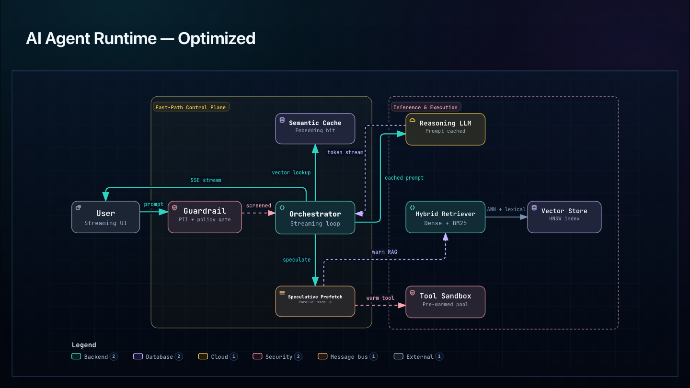
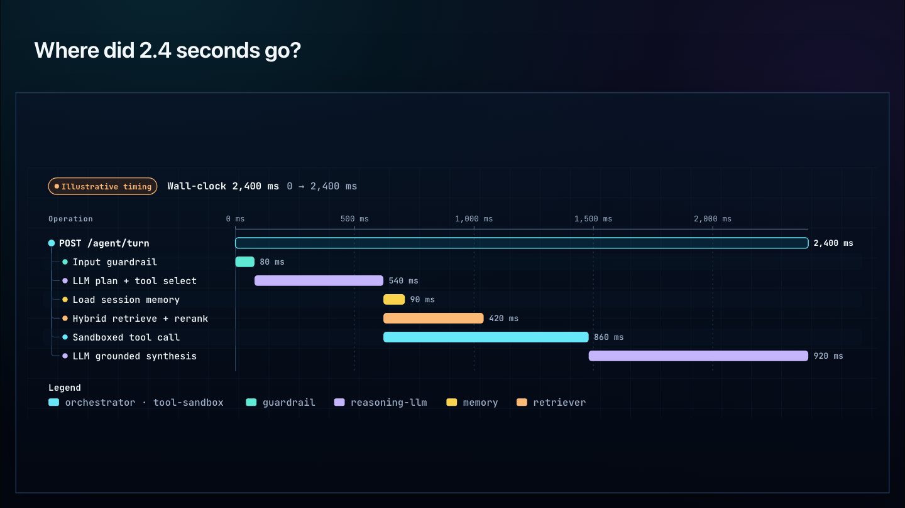
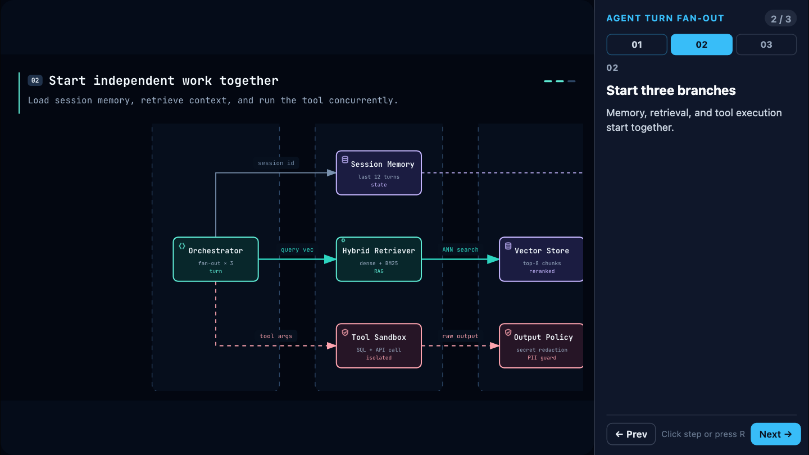
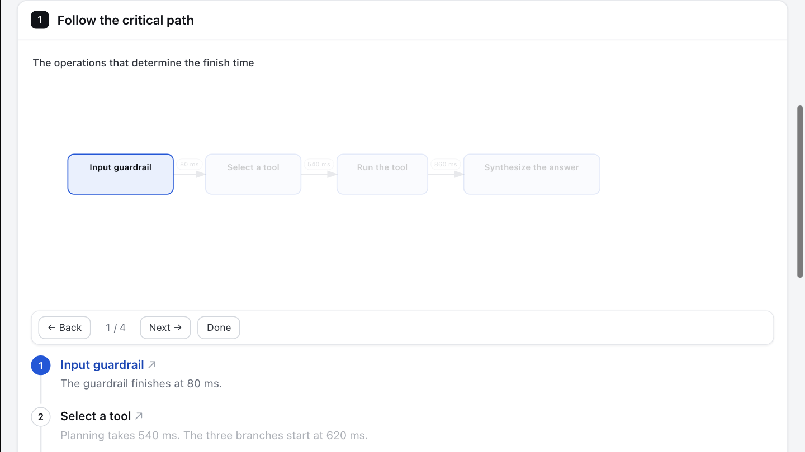

# slidev-addon-archify

A [Slidev](https://sli.dev/) addon for embedding interactive Archify diagrams, click-driven stories, and explainers in your slides.

**[Open the live showcase: Inside an AI Agent Turn](https://ksachdeva.github.io/slidev-addon-archify/)**

## Installation

From an existing Slidev project's directory, install the addon from GitHub. It isn't published to npm yet.

```sh
pnpm add -D github:ksachdeva/slidev-addon-archify
```

Add it to the first frontmatter block in `slides.md`. Slidev will discover the components automatically; no imports are needed.

```yaml
---
addons:
  - slidev-addon-archify
---
```

## Use the components

Put your **generated Archify HTML** in `public/diagrams/` in your deck. The components embed those files from the same site as the slides. The `name` prop is the filename without the suffix shown below. You only need the Archify CLI to generate the HTML, not to build or present the deck once the files exist.

| Component | Use it for | File in `public/diagrams/` |
| --- | --- | --- |
| [`ArchifyViewer`](components/ArchifyViewer.vue) | An interactive diagram or architecture comparison | `<name>.html` |
| [`ArchifyStory`](components/ArchifyStory.vue) | A story that advances with Slidev clicks | `<name>.stage.html` |
| [`ArchifyExplainer`](components/ArchifyExplainer.vue) | A scrollable explainer with embedded diagrams | `<name>.explainer.html` |
| [`StorySidePanel`](components/StorySidePanel.vue) | Optional captions and jump buttons alongside a story | None; pass a `beats` array |

### Interactive diagram

Download the [generated diagram](https://ksachdeva.github.io/slidev-addon-archify/diagrams/agent-turn-optimized.html) as `public/diagrams/agent-turn-optimized.html`, then add this slide. See it live in the [showcase](https://ksachdeva.github.io/slidev-addon-archify/#/3).

```md
---
layout: full
---

<ArchifyViewer
  name="agent-turn-optimized"
  title="AI Agent Runtime — Optimized"
  @next="$nav.next()"
  @previous="$nav.prev()"
/>
```

The event handlers keep the left and right arrow keys working when the viewer has focus.

[](https://ksachdeva.github.io/slidev-addon-archify/#/3)

[](https://ksachdeva.github.io/slidev-addon-archify/#/6)

### Click-driven story with an optional side panel

Download the [generated story stage](https://ksachdeva.github.io/slidev-addon-archify/diagrams/agent-turn-fanout.stage.html) as `public/diagrams/agent-turn-fanout.stage.html`. In the [live example](https://ksachdeva.github.io/slidev-addon-archify/#/7), use the arrow keys or click a numbered tab to jump to a beat. The [story source](showcase/diagrams/agent-turn-fanout.story.json) has three beats, including the opening view at click `0`, so set `clicks: 2` and pass one panel entry per beat.

```md
---
layout: full
clicks: 2
---

<div class="absolute inset-0 flex">
  <div class="h-full min-w-0 flex-1">
    <ArchifyStory
      name="agent-turn-fanout"
      title="From fan-out to grounded answer"
      :step="$clicks"
      :active="$page === $nav.currentPage"
      fill
      hide-loop
    />
  </div>
  <StorySidePanel
    topic="Agent turn fan-out"
    :step="$clicks"
    :beats="[
      { tag: '01', title: 'See the whole turn', summary: 'Use the tabs or Right Arrow to follow the request.' },
      { tag: '02', title: 'Start three branches', summary: 'Memory, retrieval, and tool execution start together.' },
      { tag: '03', title: 'Join before synthesis', summary: 'The context builder merges the three results.' },
    ]"
    @select="(index) => $nav.go($page, index)"
    @prev="$nav.prev()"
    @next="$nav.next()"
  />
</div>
```

For a story without a side panel, remove both layout `<div>`s and `StorySidePanel`, then replace `fill` with `full-bleed` on `ArchifyStory`.

[](https://ksachdeva.github.io/slidev-addon-archify/#/7)

### Scrollable explainer

Download the [generated explainer](https://ksachdeva.github.io/slidev-addon-archify/diagrams/agent-turn-latency.explainer.html) as `public/diagrams/agent-turn-latency.explainer.html`, then embed it as shown below. In the [live example](https://ksachdeva.github.io/slidev-addon-archify/#/8), scroll to the diagram and select **Step through**. See the [explainer source](showcase/diagrams/agent-turn-latency.archify.md) to adapt it.

```md
---
layout: full
---

<ArchifyExplainer
  name="agent-turn-latency"
  title="What holds up the agent's answer?"
  @next="$nav.next()"
  @previous="$nav.prev()"
/>
```

[](https://ksachdeva.github.io/slidev-addon-archify/#/8)

## Local development

Use Node.js 22.22.0 or newer and pnpm.

```sh
pnpm install
pnpm dev
```

The preview deck, [`showcase/slides.md`](showcase/slides.md), loads the addon from the repository root. Run `pnpm build` to build the preview into `showcase/dist/`.

The showcase keeps its diagram and story JSON and explainer Markdown in `showcase/diagrams/`. After editing them, run `pnpm diagrams` and commit the sources together with the regenerated HTML in `showcase/public/diagrams/`. The script uses the Archify skill installed in `.agents/skills/archify` by default; set `ARCHIFY_CLI` to use another installation.

Archify runs a browser check when generating diagrams. The dev container includes Chromium, and `pnpm diagrams` disables Chromium's sandbox for that command so it works under Docker. Run it only with trusted inputs. To keep the browser sandbox enabled, run `node showcase/generate-diagrams.mjs` from a host terminal with Chrome or Chromium installed.

Neither `pnpm dev` nor the GitHub Pages build runs Archify; both use the checked-in HTML.
